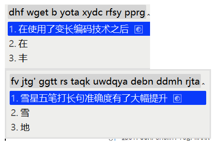
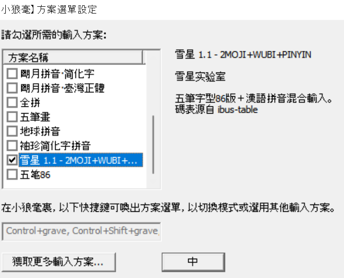
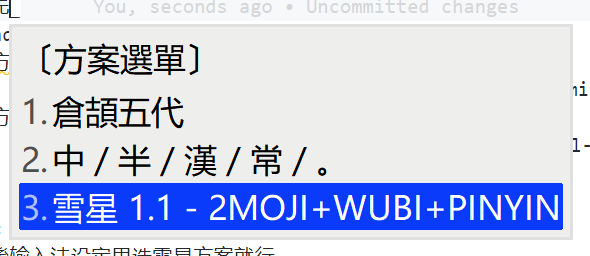

# rime-snomiao iRime

- 语言: [English](./README.md) | [简体中文]
- 版本历史: [CHANGELOG](./CHANGELOG.md) · [Releases](https://github.com/snomiao/rime-snomiao/releases)

## 方案列表/特性

### 雪星五笔 ⌨️



- 基于微软五笔码表改进了变长编码技术, 五笔长句输入效率大幅提升

## 安装与配置 🗳️

### Install in Mac、OSX に使用する 🍎

1. Install squirrel by 在这里安装 squirrel （rime の mac に分支）。

   1. [rime.im](https://rime.im) (official website)s
   2. or `brew install squirrel --cask`

2. Install rime-snomiao receipe 安装 rime-snomiao receipe

   ```shell
   git clone https://github.com/snomiao/rime-snomiao
   cd rime-snomiao
   git pull origin
   cp -r ./* ~/Library/Rime/
   ```

3. 屏幕右上角，输入法下拉菜单，点击 Deploy 载入

- TODO, PR’s welcome

### 在 Windows 安裝 🪟

1. 首先安装 Weasel 输入法，
   官方网站：[下載及安裝 | RIME | 中州韻輸入法引擎](https://rime.im/download/)
   或使用 Chocolatey 安装 `cup weasel`

2. 安装本输入方案

- 方法 0
  - 下载 Release 然后解压到 `C:\Users\你的用户名\AppData\Roaming\Rime`
  - https://github.com/snomiao/rime-snomiao/releases/
- 方法 1
  - 將本項目下載解压，将 `./Rime` 目録裏的内容复制到：`C:\Users\你的用户名\AppData\Roaming\Rime` (即 %APPDATA%\Rime )
  - [配置](#配置) 输入法（或重启系统）
  <!-- - 方法 2
  - 運行
    ````
    git clone https://github.com/snomiao/rime-snomiao
    cd rime-snomiao
    git pull
    cd devtools
    install.bat
    ``` -->
- 方法 3 （自动）
  - 運行 `npx rime-snomiao@latest`
    注意本输入方案无法使用东风破 (plum) 安装。

1. 安装完成后，请 [配置](#配置) 输入法

### Linux 🐧

- TODO, PR’s welcome

## 配置

| WeaselDeployer.exe          | F4                          |
| --------------------------- | --------------------------- |
|  |  |

### Custom / カスタム / 自定義

顔文字在 [kaomoji.dict.yaml](./kaomoji.dict.yaml) 里修改（黙認不使用，需要手動引入）

- [Emoji / 絵文字 / Emoji](./Rime/opencc/zh_emoji_word.json)
- [JPN Japanese 日本語方案](./Rime/sno_japanese.schema.yaml)
- [CHN Chinese 中国語方案](./Rime/sno_chinese.schema.yaml)

拼音可以在 `` 里改

```yaml
dependencies:
  - pinyin_simp
```

五笔可以自己换 98 或别的，位置如下

```yaml
translator:
  dictionary: wubi86
```

## Dictionary contribute 詞典贡献

Dictionary contribute 詞典贡献

1. fork rime-snomiao to your account, and clone to local
2. put this dictionary into /dict
3. git commit -a -m "YOUR dictionary NAME"
4. git push
5. view your forked branch in github
6. PR button should shown, click it

## LICENSE

本項目 Copyleft，本項目爱用就拿去。

（但如果需要做商用的話得注意項目中包含的其它幾個方案的 license（但应该没有這様的人吧……），如果有這種需求請参見 Reference 电進去自己看他們的 License）

## rime-snomiao 小白鼠用户交流群

telegram: @rime_snomiao https://t.me/rime_snomiao

## References & ThanksTo

- [Full Emoji Database](https://www.kaggle.com/datasets/eliasdabbas/emoji-data-descriptions-codepoints?resource=download)
- [中日英自然码（带辅码）双拼输入法](https://github.com/lippmann/lrime)
- [Rime double pinyin plus](https://github.com/mutoe/rime)
- [OpenCC](https://github.com/BYVoid/OpenCC)
- [rime/rime-pinyin-simp: 【袖珍簡化字拼音】輸入方案](https://github.com/rime/rime-pinyin-simp)
- [rime/rime-wubi: 【五筆字型】輸入方案](https://github.com/rime/rime-wubi)
- [gkovacs/rime-japanese: 日语输入法 Input method for typing Japanese with RIME](https://github.com/gkovacs/rime-japanese/)
- [日本人名地名平假名汉字双向词典](https://mdict.org/post/riben-renming-diming/)
- [Mouse Dictionary](https://github.com/wtetsu/mouse-dictionary/wiki/Download-dictionary-data)

## About

### Author 👩‍💻

Author: snomiao <snomiao@gmail.com>
Website: [snomiao.com](https://snomiao.com)

### Sponsors 💰

- None yet.

Claim your sponsorship by donating snomiao <[Email: snomiao@gmail.com](mailto:snomiao@gmail.com)>

### Contribute 💻

The main repo is in [here](https://github.com/snomiao/rime-snomiao#readme), any issue and PR's welcome.

### Published 📰

rime-snomiao 雪星的小狼毫输入法方案

- [github.com/snomiao](https://github.com/snomiao/rime-snomiao)
- [gitee.com/snomiao](https://gitee.com/snomiao/rime-snomiao)
- [github.com/rime/home](https://github.com/rime/home/issues/68#issuecomment-1383913014)
- [Zhihu](https://zhuanlan.zhihu.com/p/599268754)
- [Telegram Rime](https://t.me/loverime/41196)
- [V2EX](https://www.v2ex.com/t/909117)
- [Twitter](https://twitter.com/snomiao/status/1614586337822375936)
